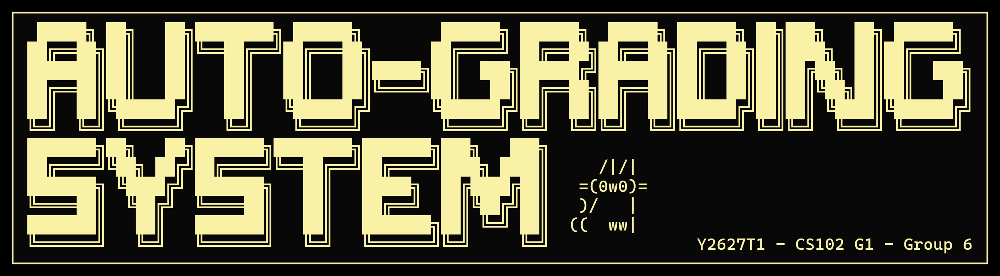

# CS102 Auto-Grading System

A local command-line grader for CS102 Java submissions. It compares student programs with instructor tester programs, records marks in a CSV scoresheet, and writes an HTML report. It runs `javac` and `java` directly on the local machine, so use it only with code you trust or in an isolated environment.

## 1. Prerequisites

- JDK 17 or newer. Both `java` and `javac` must be on `PATH`.
- Either Maven 3.9+ or the JARs checked into `lib/`.
- A terminal. On Windows, use the `.bat` scripts; on macOS/Linux, use the `.sh` scripts.

```text
$ java -version
$ javac -version
$ mvn -version                 # only needed for Maven builds/tests
```

## 2. Build

From the repository root, choose one route:

### Maven

```sh
mvn test
mvn package
java -jar target/CS102-Auto-Grading-System-1.0-SNAPSHOT.jar
```

`mvn package` creates a runnable shaded JAR and `target/` contains build/test output.

### Bundled libraries

```sh
./compile.sh                  # macOS/Linux
./run.sh
```

On Windows:

```bat
compile.bat
run.bat
```

`compile.sh`/`compile.bat` compile `src/main/java` into `classes/` using the checked-in JARs in `lib/`; they do not download dependencies. Run the launcher from the repository root because the application reads `assets/title.txt` and `assets/welcome.md` using relative paths. `--debug` is an optional launcher argument that prints a stack trace for an unexpected startup/runtime exception.

## 3. Prepare the three configured inputs

The first launch asks for these paths. **Every path must be absolute**, and the prompt checks that folders/files exist.

1. **Starting Folder** - the blank assignment/template folder. Its question folders and required files define what preflight checks.
2. **Tester Files Folder** - one folder per question, containing tester source files.
3. **Scoresheet File** - a `.csv` file. It must have a `Username` column, or the grading-compatible `student` column. Course sheets may also contain `Calculated Final Grade Numerator`, `Calculated Final Grade Denominator`, and `End-of-Line Indicator`; optional `Email`, `First Name`, and `Last Name` columns supply header information. The configured file is read but never overwritten. The grader writes a new timestamped export after a successful run.

A tester source is a regular Java file ending in `Tester.java` (for example, `Q1aTester.java`). Put its expected output beside it as `Q1aTester.expected.txt`. Each tester that produces exactly the expected UTF-8 text earns one mark. `\r\n` and `\n` are treated as equivalent, but other whitespace is significant.

A typical assignment is arranged as follows:

```text
assignment/
  starting-folder/                 # blank template configured in menu
    Q1/
      Q1a.java
      persons.txt                  # optional/resource file if the template has it
    Q2/
      Q2.java
  testers/                         # Tester Files Folder
    Q1/
      Q1aTester.java
      Q1aTester.expected.txt
    Q2/
      Q2aTester.java
      Q2aTester.expected.txt
  # Alternatively, testers/ may contain flat Q1aTester.java files and matching expected files.
  scores.csv                       # Username or student column; one row/student
  submissions/                     # selected later in the grading flow
    alice/
      Q1/Q1a.java
      Q2/Q2.java
    2024-0002-bob.zip              # archives are extracted into a working copy
```

Student question folders normally sit directly below each student folder. The grader also tolerates one wrapper folder (for example `bob/RenameToYourStudentID/Q1`) and preflight reports it. Student Java files and resources are copied into a temporary build directory per question; hidden files and `.class` files are ignored.

## 4. Launch and configure

Start with `./run.sh`, `run.bat`, or the Maven-built JAR. On a first run, the welcome screen asks for the three paths, then:

```text
Enter Grading timeout in seconds (2):
Enter Output limit in bytes (1048576):
[SUCCESS] Configuration saved!
```

Press Enter to keep a displayed value. Timeout accepts 1-3600 seconds per compile/test process. Output limit accepts 1-67108864 bytes of combined stdout/stderr per process. Settings are saved in `config.json` in the current directory. If an existing setting is missing or invalid, the defaults are 2 seconds and 1048576 bytes.

The main menu is:

```text
1. View configuration paths
2. Edit configuration paths
3. Grade students (run auto-grader)
4. View Recent HTML Report
5. Clear Student Grading Cache
0. Quit Application
```

- **1** displays the starting folder, tester folder, scoresheet, timeout, and output limit.
- **2** re-prompts for all three paths and both limits; Enter keeps each current value.
- **3** starts the complete journey below.
- **4** opens `.grader-report.html` in the default browser. On a headless/SSH machine it prints the path instead; before the first grade it reports that no report exists.
- **5** deletes the local `cache/` working-copy directory. Use this when you need to rebuild a submission copy from the original files.
- **0** exits.

## 5. Select submissions and preflight

Choose **3**, then give an absolute **Submissions Folder** path. The program immediately clears the cache and creates/reuses a working copy under `cache/<submissions-folder-name>/`. It copies folders and extracts ZIPs; the original submissions folder is never edited. It recognizes ordinary folders, ZIPs beside the folder, and archives named like `2024-0002-username.zip`. It ignores OS clutter such as `.DS_Store` and `__MACOSX`; symlinks are not followed.

It then performs a read-only submission check against the Starting Folder. The check reports fatal setup problems and per-student findings such as:

- missing/unreadable template or submissions folder;
- an unextracted archive, template copy, or wrapper folder;
- missing/misnamed question folders, Java files, or template resources;
- empty files, extra files, unreadable items, or symlinks;
- Java files with a missing or incomplete `Name`/`Email ID` header; and
- a folder name that is close to a scoresheet username and may be a typo.

The report ends with counts of ready, needs-attention, and not-graded folders. This stage does not compile, grade, or modify anything.

The grader menu is:

```text
1. Fix common mistakes automatically
2. Check the working copy again
3. Start grading
0. Cancel and return to the main menu
```

- **1** works only on the cached copy. It can flatten a wrapper folder, rename a likely username typo after a `Y/N` confirmation, add/correct a Java header, and restore missing questions/files/resources. Restoration first tries the original submission and then the Starting Folder. It also synchronizes non-Java resources with the Starting Folder: template resources replace student versions, missing resources are restored, and non-Java files absent from the template are removed. Java files are not modified or deleted. A header naming another registered student is reported for human attention rather than silently changed.
- **2** repeats the read-only check after you manually edit the cached copy.
- **3** accepts the current copy and begins grading, even if a student still has findings; unresolved problems become grading errors or zero marks where applicable.
- **0** abandons this run without grading.

After option 1, read the `__ Submission validation __` output. It reports fixed events and events still needing attention, followed by a reminder to run the check again. Select option 2 to confirm the resulting layout. Only the cache is changed, never the original submission folders or the Starting Folder.

## 6. Run grading

Select **3. Start grading** in the grader menu. The program processes each student and each question independently:

1. It finds the question folder (including the supported single wrapper case).
2. It copies the student's source/resource files and relevant existing `.class` files, plus the instructor's `*Tester.java` files, into a fresh temporary directory.
3. It runs one bounded `javac` process for that question. If the configured tester folder contains flat `*Tester.java` files, the grader groups them into question folders using the leading question name (for example, `Q1aTester.java` becomes part of `Q1`).
4. It runs each tester as a bounded `java` process and compares its output with the matching `.expected.txt`.
5. It awards one mark per passing tester and updates the configured scoresheet.

A compile error, missing question/file/tester/expected file, runtime exception, timeout, output-limit violation, or output mismatch is reported with context and does not stop unrelated students or questions. A missing/unreadable submissions folder, tester folder, or scoresheet is fatal and prevents grading. A template-copy submission named exactly like the Starting Folder is listed as `not graded` and skipped.

Example output from a real run:

```text
__ Submission check (template: template) __
alice ...................... needs attention
  [MISSING_HEADER] alice/Q1/Main.java - Java file is missing a header. -> Choose "Fix common mistakes automatically" to add or repair the header.

--- Grader Options ---
1. Fix common mistakes automatically
2. Check the working copy again
3. Start grading
0. Cancel and return to the main menu
Enter option: 3
[INFO] Running autograder!
PASS student=alice submission=.../cache/submissions/alice question=Q1 tester=Q1aTester score=1
```

The grader runs student code as the local user without a sandbox. The timeout and output limit are resource limits, not security isolation.

## 7. Read the outputs

At the end of a successful grading run, the program prints paths for:

- **Configured scoresheet** - read and validated as input; it is never changed by grading.
- **HTML report** - `.grader-report.html` in the current directory. It contains scores and all recorded diagnostics and can be opened through main-menu option 4.
- **Score export** - the new timestamped CSV printed as `Score export: ...`. It contains the graded usernames, question columns, `final_score`, and a `% full marks` row. This is the updated score sheet to submit or import.
- **Error history** - `.grader-error-history.jsonl`, one JSON object per recorded issue. It is append-only across runs.

The console finishes with a summary such as:

```text
HTML report: .../.grader-report.html
Score export: .../2026-11-11_11-41-29-889778000.csv
[INFO] Completed: 1 submission(s), 0 reported issue(s).
```

Generated files are local run state. Keep the configured scoresheet as the source input and retain the timestamped export as the result. Remove generated cache/report/export/history files when resetting a run.

## 8. Common errors and fixes

| Message or symptom | Resolution |
| --- | --- |
| `The path must be absolute` or `File not found` | Paste an existing absolute path. Check folder/file type and that the scoresheet ends in `.csv`. |
| No `Username` or `student` column | Add one of those exact header names to the first CSV row. |
| `Autograder not started because submission setup is invalid` | Fix the Starting Folder or Submissions Folder, permissions, or empty question layout, then choose option 2 or restart. |
| `UNEXTRACTED_ARCHIVE`, `WRAPPED_FOLDER`, or username typo | Choose option 1, answer its confirmation prompts, then choose option 2. Otherwise repair the cached copy manually. |
| `MISSING_HEADER` / `INCOMPLETE_HEADER` | Choose option 1 to add/correct `Name:` and `Email ID:` in the first ten lines, or edit the cached Java file. |
| `missing-tester` or `missing-expected` | Put `<Name>Tester.java` and `<Name>Tester.expected.txt` together in the matching tester question folder. |
| Compile error or missing resource | Restore the template's required files and correct Java names/classes. Check the detailed error in the console, HTML report, or JSONL history. |
| Runtime/timeout/output-limit/output-mismatch | Fix the student's program or tester expected text. Increase the configured limit only when the assignment genuinely needs it. |
| Report will not open | On a headless system open `.grader-report.html` manually. Run option 3 first if it does not exist. |
| Stale or wrong working copy | Select main-menu option 5, then start option 3 again. |

## 9. Development checks

```sh
mvn test
mvn package
git diff --check
```

The checked-in `DemoRunner` class expects a `demo/fixtures` tree and is not the interactive launcher; use the interactive flow above unless those fixture files have been supplied separately.

## 10. Assets Credit

The [big title ASCII art](./assets/title.txt) is generated from [www.asciiart.eu](https://www.asciiart.eu/text-to-ascii-art) With "ANSI Shadow" font and "Box drawing light" border. Everything else ([Welcome message](./assets/welcome.md) and the cat in the title) are self made.

[Libraries](./lib/) used can be found in [pom.xml](./pom.xml).
